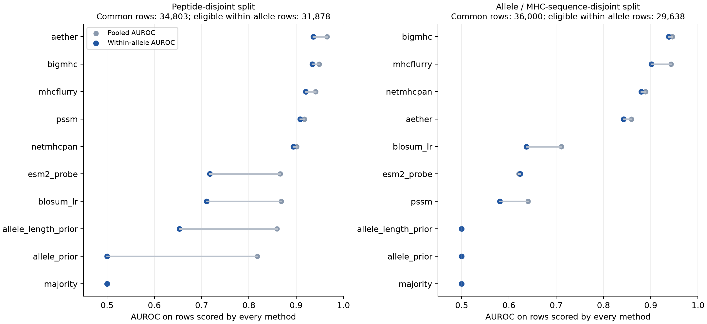

# Clean AETHER benchmarks — 2026-10-27

Clean 10-epoch runs use the frozen ESM2-650M backbone and the existing two-layer
interaction head. Each run uses four GPUs with total batch size 64 and seed 1337.
Checkpoints are selected by within-allele validation AUROC, independently of the test set.
Source snapshots, checkpoints and predictions remain together in the recorded run directories.
Small metrics and provenance files are retained here for version control.

AETHER narrowly leads the peptide-disjoint comparison: within-allele AUROC 0.936, against BigMHC 0.934. The difference is small and comes from one seed.

On the separately trained allele/MHC-sequence-disjoint protocol, AETHER reaches 0.843, below BigMHC 0.938, MHCflurry 0.901, and NetMHCpan 0.880. These results do not support an overall pan-allele leadership claim. External tools may have seen these alleles or records during pretraining.



## Peptide-disjoint

Checkpoint: `outputs/clean_peptide_20261027/best.pt` (selected epoch 9 after 10 training epochs; SHA-256 `b20a6bbc199b57e904921e25ac9dc666df387ec4af91dfda7694221ede48ee3b`).

Common scored population: 34,803 rows. Within-allele AUROC: 66 eligible alleles, 31,878 rows.

| Method | Pooled AUROC | Within-allele AUROC | AUPRC | PPV@100 | Coverage |
| --- | ---: | ---: | ---: | ---: | ---: |
| aether | 0.966 | 0.936 | 0.988 | 1.000 | 100.0% |
| bigmhc | 0.949 | 0.934 | 0.983 | 1.000 | 98.5% |
| mhcflurry | 0.941 | 0.920 | 0.980 | 1.000 | 98.5% |
| pssm | 0.918 | 0.908 | 0.971 | 0.990 | 100.0% |
| netmhcpan | 0.901 | 0.894 | 0.968 | 1.000 | 98.5% |
| esm2_probe | 0.866 | 0.717 | 0.952 | 1.000 | 100.0% |
| blosum_lr | 0.868 | 0.711 | 0.951 | 1.000 | 100.0% |
| allele_length_prior | 0.859 | 0.653 | 0.950 | 0.999 | 100.0% |
| allele_prior | 0.818 | 0.500 | 0.929 | 1.000 | 100.0% |
| majority | 0.500 | 0.500 | 0.755 | 0.755 | 100.0% |

Pooled AUROC, AUPRC and PPV@100 use all common scored rows. Within-allele AUROC uses the eligible allele population counted above. Coverage is against the full test split.

AETHER exceeds mhcflurry on 36/66 eligible alleles (1 ties); median allele AUROC difference +0.007, support-weighted difference +0.016.
AETHER exceeds bigmhc on 35/66 eligible alleles (0 ties); median allele AUROC difference +0.003, support-weighted difference +0.002.
AETHER exceeds netmhcpan on 40/66 eligible alleles (1 ties); median allele AUROC difference +0.016, support-weighted difference +0.042.
AETHER exceeds pssm on 47/66 eligible alleles (0 ties); median allele AUROC difference +0.014, support-weighted difference +0.028.

## Held-out alleles and MHC sequences

Checkpoint: `outputs/heldout_allele_sequence_20261027/best.pt` (selected epoch 5 after 10 training epochs; SHA-256 `e7ee8c386997fe473edf53e9f0759730b6d1dd8a1183319b8808657e88410b5b`).

Common scored population: 36,000 rows. Within-allele AUROC: 20 eligible alleles, 29,638 rows.

| Method | Pooled AUROC | Within-allele AUROC | AUPRC | PPV@100 | Coverage |
| --- | ---: | ---: | ---: | ---: | ---: |
| bigmhc | 0.946 | 0.938 | 0.987 | 1.000 | 97.7% |
| mhcflurry | 0.943 | 0.901 | 0.986 | 0.990 | 97.7% |
| netmhcpan | 0.889 | 0.880 | 0.974 | 1.000 | 97.7% |
| aether | 0.859 | 0.843 | 0.959 | 1.000 | 100.0% |
| blosum_lr | 0.711 | 0.637 | 0.910 | 0.990 | 100.0% |
| esm2_probe | 0.621 | 0.624 | 0.846 | 1.000 | 100.0% |
| pssm | 0.640 | 0.581 | 0.875 | 0.920 | 100.0% |
| majority | 0.500 | 0.500 | 0.814 | 0.814 | 100.0% |
| allele_prior | 0.500 | 0.500 | 0.814 | 0.814 | 100.0% |
| allele_length_prior | 0.500 | 0.500 | 0.814 | 0.814 | 100.0% |

Pooled AUROC, AUPRC and PPV@100 use all common scored rows. Within-allele AUROC uses the eligible allele population counted above. Coverage is against the full test split.

AETHER exceeds mhcflurry on 4/20 eligible alleles (0 ties); median allele AUROC difference -0.015, support-weighted difference -0.059.
AETHER exceeds bigmhc on 6/20 eligible alleles (0 ties); median allele AUROC difference -0.031, support-weighted difference -0.095.
AETHER exceeds netmhcpan on 5/20 eligible alleles (0 ties); median allele AUROC difference -0.029, support-weighted difference -0.037.
AETHER exceeds pssm on 18/20 eligible alleles (0 ties); median allele AUROC difference +0.369, support-weighted difference +0.262.

## Interpretation and limits

- Pooled AUROC can reflect allele separation. Within-allele AUROC is support weighted over alleles with both labels and at least 50 common scored rows; it is not a macro average.
- The complete peptide test split has 35,339 rows across 146 alleles. Only 66 alleles qualify for the default within-allele aggregate; the original statement that all 35,339 rows were across 66 alleles conflates these populations.
- AUPRC is average precision. PPV@100 uses min(100, scored rows), with expected credit for ties at the cutoff. Per-allele tables expose allele-prior effects on triage.
- The ESM2 linear probe fits 100,000 training rows; its gap to AETHER also reflects training-set size.
- The held-out-allele model is trained separately with both allele names and encoded MHC sequences disjoint across splits. Peptides may recur across alleles. External pretrained tools are not known to have held these alleles out.
- The peptide partition is frozen in peptide_split_assignments.csv.gz. Use neoantigen.data.regroup --assignments_file to restore its membership and row order; peptide_split_restoration.json verifies all three canonical hashes.
- The roughly 0.32 pooled-versus-within gap belongs to the allele-prior baseline, not a universal correction for all models. The two protocols have different test populations, so their score difference does not isolate the causal effect of holding alleles out.
- NetMHCpan 4.2d uses standard EL scores, without neoepitope fine-tuning; BigMHC and MHCflurry use presentation models. Their training data may overlap IEDB/CEDAR. These results do not prove independent prospective performance.
- These are single-seed runs. High-support alleles dominate the weighted result; per-allele wins/medians should accompany aggregate claims.
- CEDAR label noise, limited independent negatives, and overlap with phase-one data remain limitations. No claim of validated immunogenicity, presentation or TCR prediction follows from this binding benchmark.
- The working tree already has an optional TCR head; it was not retrained in these binding experiments. Attention export now provides existing interaction and pooling weights, with no causal interpretation asserted.

## Reproduction and validation

The peptide run uses 279,527 training rows; the allele run uses 274,923. Input file hashes, cleanup counts and split checks are recorded in [data_audit.json](data_audit.json).

The original row split had 63.1% unique-peptide overlap, 35.8% unique-pair overlap, and 27.5% pooled exact duplicates. The peptide split has zero on all three. The allele split has no shared allele names or encoded MHC sequences; shared peptides across different alleles are permitted.

Restore the exact peptide partition and row order from the AETHER root into a fresh directory:

```bash
python -m neoantigen.data.regroup --in_dir data/mhcattnnet/classI --out_dir outputs/restored_split --assignments_file results/20261027/peptide_split_assignments.csv.gz
```

[Restoration verification](peptide_split_restoration.json) matches the training run’s canonical hashes for train, validation and test. Random regrouping defaults create a different valid partition of the same cleaned corpus.

Checkpoint, source snapshot, data hash and best-epoch checks are recorded in [peptide verification](peptide/verification.json) and [allele verification](heldout_allele/verification.json). Standalone allele evaluation also verifies against the checkpoint’s actual training data. Runtime events are retained in [runtime_events.json](runtime_events.json).

[Attention example](peptide/attention_example.png), [token metadata](peptide/attention_example.json), and [full attention arrays](peptide/attention_example.npz) come from the clean peptide checkpoint. The example uses CPU float32 inference; benchmark scoring used the recorded GPU/AMP configuration. The weights are descriptive attention, not causal attribution.

NetMHCpan/BigMHC source and weight hashes, MHCflurry model hashes, the MHCflurry environment, and its model-release download record are retained alongside this report. Known contradictory pairs are removed by regrouping; rows explicitly marked label_conflict by the CEDAR builder are excluded during loading. These steps do not resolve all label noise.

## Expanded 9-mer attention and plots

The [multi-peptide analysis](attention_analysis.md) covers 2,977 peptide–allele pairs and 10,944 single substitutions. P2/P9 dominate substitution sensitivity, while pooling is nearly uniform; MHC-to-peptide attention emphasizes P1/P2/P9. See the [complete plot gallery](plots/README.md) for PNG figures, allele motifs, multiple examples, and additional performance plots for both protocols. The executed notebook is [05_results_20261027.ipynb](../../figures/05_results_20261027.ipynb).
