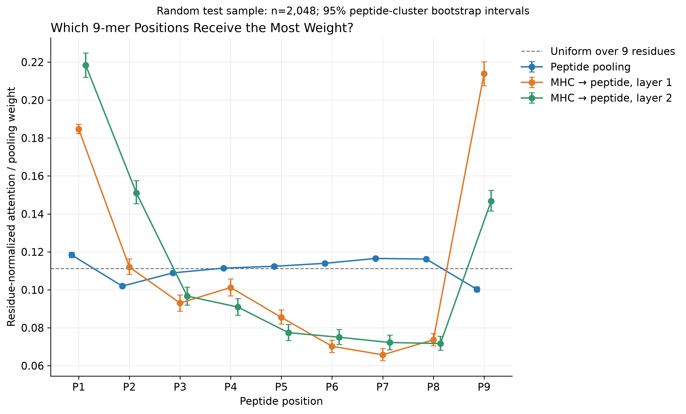
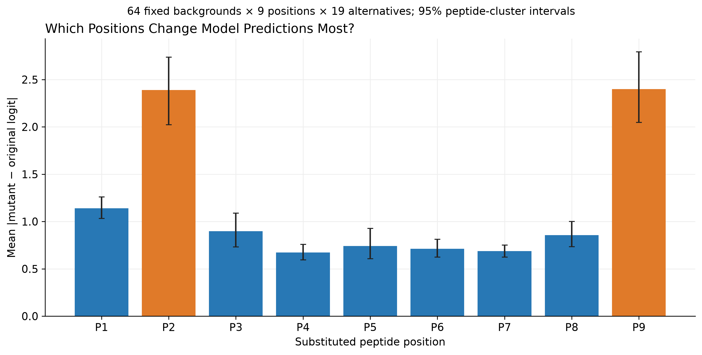
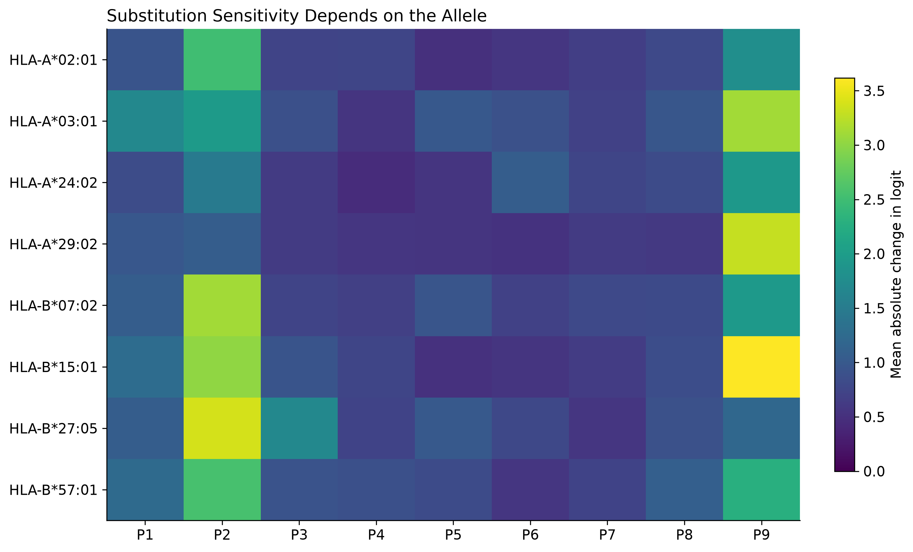
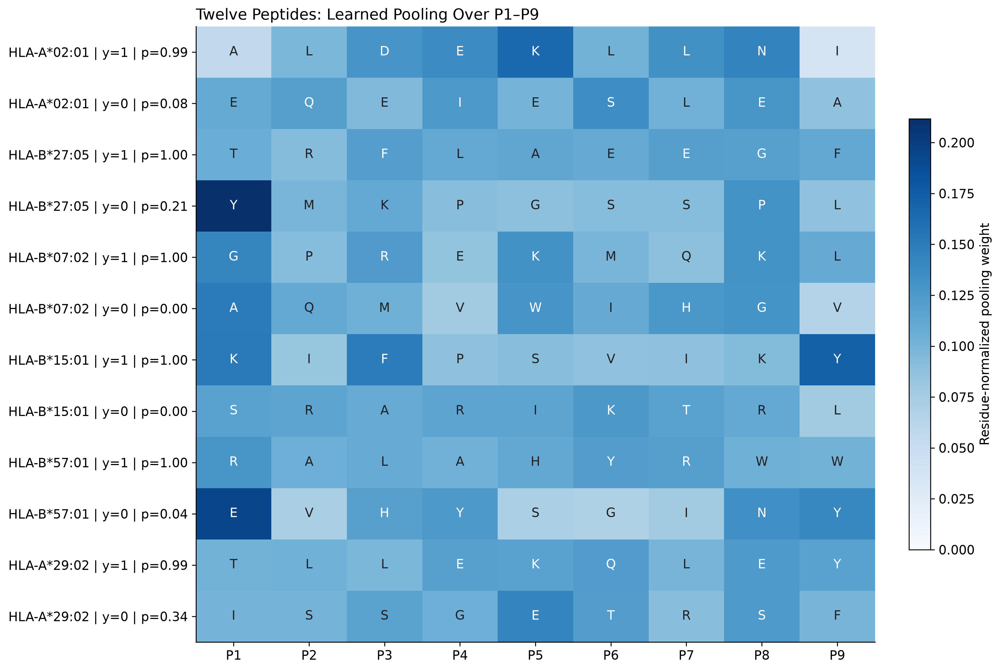

# 9-mer attention and model sensitivity — 2026-10-27

P2 and P9 are the most prediction-sensitive positions in the substitution analysis. Final-layer MHC-to-peptide attention instead ranks P1, P2, then P9. Learned peptide pooling is comparatively flat and does not identify the most sensitive positions. These are three different quantities; a single attention heatmap cannot substitute for all three.

## Position-level results



All attention percentages below are normalized **within P1–P9**, after removing CLS/EOS from each example. The uniform reference is 11.11%. Substitution sensitivity is the mean absolute change in output logit across 19 non-native amino acids, then across 64 backgrounds.

| Position | Peptide pooling | MHC → peptide, layer 1 | MHC → peptide, layer 2 | Mean absolute substitution Δlogit |
| --- | ---: | ---: | ---: | ---: |
| P1 | 11.84% | 18.47% | 21.83% | 1.140 |
| P2 | 10.20% | 11.20% | 15.10% | 2.390 |
| P3 | 10.89% | 9.30% | 9.67% | 0.898 |
| P4 | 11.14% | 10.12% | 9.09% | 0.672 |
| P5 | 11.24% | 8.55% | 7.74% | 0.741 |
| P6 | 11.40% | 7.03% | 7.50% | 0.712 |
| P7 | 11.65% | 6.57% | 7.22% | 0.688 |
| P8 | 11.62% | 7.37% | 7.17% | 0.857 |
| P9 | 10.02% | 21.39% | 14.67% | 2.399 |

- **Pooling:** P1 ranks first, followed by P7/P8, but weights span only about 10.0–11.8%. Pooling ranks P2 and P9 near the bottom even though substitutions at these positions affect predictions most.
- **Cross-attention:** layer 1 gives P9 about 21.4% and P1 18.5%; layer 2 shifts to P1 21.8%, P2 15.1%, P9 14.7%. Layer dependence is a reason to avoid a single universal “importance” ranking.
- **Special tokens:** CLS/EOS together receive 20.6% of original peptide pooling mass and 14.1% of layer-2 incoming attention on average. The residue-only normalization hides this mass unless it is shown separately.
- **Sensitivity:** P2 and P9 average 2.39 and 2.40 absolute logit change. Their combined mean is **3.38×** the mean for P4–P6 (2.394 versus 0.709). The anchor mean exceeds the center mean in all 64 sampled backgrounds. The paired mean anchor-minus-center difference is 1.686 logits (95% peptide-cluster bootstrap interval 1.429–1.983). P1 is next at 1.14. P9 and P2 should be treated as similarly sensitive, rather than interpreting their tiny mean difference as an established ordering.
- **Attention versus sensitivity:** pooled Spearman correlation between pooling weight and substitution sensitivity is −0.035; median within-peptide correlation is −0.05. Pooling weight is a poor position-importance proxy in this analysis. This correlation concerns pooling, not every attention mechanism.



## Biological interpretation

The strong P2/P9 substitution effects are consistent with common class-I peptide anchor positions, which are often the second and final residues. Anchor specificity varies by allele; see the primary [MHC Motif Atlas paper](https://academic.oup.com/nar/article/51/D1/D428/6786193). This consistency supports an anchor-sensitive model behavior hypothesis; it does not establish physical contacts or energetic contributions.

Allele-specific effects are visible even in this small scan: HLA-B*27:05 is more sensitive at P2 (3.38) than P9 (1.20), whereas HLA-A*29:02 is more sensitive at P9 (3.29) than P2 (1.07). These are exploratory means from eight backgrounds per allele, including four positives and four negatives, not precise population estimates.



Observed motifs from **all available test 9-mers** provide a separate check. Examples from the data:

| Allele | Frequent residues among observed positives | Positive 9-mers | Negative 9-mers |
| --- | --- | ---: | ---: |
| HLA-A*02:01 | P2 L; P9 V/L | 1242 | 528 |
| HLA-B*27:05 | P2 R | 896 | 176 |
| HLA-B*07:02 | P2 P; P9 L | 684 | 259 |
| HLA-A*03:01 | P9 K | 349 | 345 |
| HLA-A*24:02 | P2 Y; P9 F/L | 436 | 165 |
| HLA-B*57:01 | P9 W/F | 604 | 153 |

These frequencies describe the test labels. They do not independently demonstrate that the neural model uses each residue preference. The eight motif enrichment plots contrast positive and negative frequencies within each allele with a +1 amino-acid pseudocount. Rare-residue enrichment can be unstable; the exported counts should accompany interpretation. The computational substitution identity heatmap tests model response separately and excludes each native residue, so destination-residue support varies.

Positive-background substitutions generally lower the output, while changes in negative backgrounds may improve or worsen it; the signed-effect plot separates these populations. A large absolute effect can mean either a gain or a loss. Effects are reported in logits to avoid hiding changes in saturated sigmoid probabilities.

Attention weights reflect contextualized token representations after ESM2 and interaction layers, residual connections, and self-attention. A weight assigned to P1 can therefore carry information from other residues. Peptide→MHC rows each sum to one; summing their outgoing attention cannot rank peptide positions. We instead average **MHC→peptide** attention over real MHC-residue queries, retaining the peptide key axis. All exported cross-attention is averaged over heads. MHC sequence indices in example plots are input-sequence positions, not validated structural contact coordinates.

Lower central-position sensitivity in this binding model says nothing about TCR recognition or immunogenicity. This checkpoint has no trained TCR objective. Attention is descriptive, and computational substitutions establish dependence of model outputs rather than causal biological effects; see [Jain & Wallace, 2019](https://aclanthology.org/N19-1357/).

## Multiple peptide examples



The panel includes six alleles, one observed positive and one observed negative per allele. The examples are selected by a deterministic input-row rule within the balanced random sample, independently of model confidence. Four additional peptide→MHC heatmaps retain the original example style, with P1–P9 and real MHC residues. Twelve complete, unnormalized per-example NPZ exports preserve all model interaction layers and pooling weights.

## Cohorts, precision, and uncertainty

- The full peptide-disjoint test set contains 21,940 9-mer peptide–allele pairs. A seed-1337 uniform random sample of **2,048 pairs** supplies population summaries. A separate sample contains **1,024 pairs: 16 alleles × 32 positives × 32 negatives**. The union requires 2,977 model evaluations and contains 2,230 unique peptide sequences. Cohort membership is retained in `cohort.csv`.
- The balanced cohort compares well-supported alleles at equal label prevalence. It is not representative of the test allele distribution, prevalence, or rare alleles. Position summaries use only the random cohort; allele and label panels use only the balanced cohort.
- Exhaustive single-substitution scans use **64 fixed random backgrounds across eight alleles**, four positives and four negatives per allele, with 9 positions × 19 alternatives = **10,944 substitutions**. Backgrounds are selected independently of prediction confidence. These scans cover a smaller, deliberately balanced population than the random attention cohort.
- Confidence intervals use 1,000 peptide-cluster bootstrap replicates, preserving repeated peptide occurrences across alleles. Substitution comparisons use one mean per background and position, not 19 alternatives as independent biological replicates. These intervals describe sampling variability for this one checkpoint; they exclude training-seed variability and experimental uncertainty.
- Inference uses the unchanged best peptide checkpoint in GPU float32 with AMP and TF32 disabled and float32 cached MHC embeddings. The cached/direct check agrees within 0.000009 logit. The original example was CPU float32; audited benchmark scoring used GPU/AMP and its recorded cache configuration.
- Relative to recorded benchmark probabilities, median absolute difference is 0.000367, the 99th percentile is 0.0206, and the maximum is 0.0796. **The float32 analysis is not numerically identical to benchmark inference.** The precision comparison plot and row-level table expose this; benchmark plots continue to use the original audited scores. Substitution deltas compare float32 outputs against float32 originals.
- Checkpoint identity, input hashes, source script hash, software versions, and numerical checks are in [the analysis manifest](peptide/attention_cohort/manifest.json).

## Additional benchmark plots

The [plot gallery](plots/README.md) includes ROC and precision–recall overlays, AETHER reliability, performance by peptide length, per-allele differences against three external methods, and validation learning curves for **both** peptide-disjoint and held-out-allele protocols.

ROC/PR and calibration use the same intersection across all ten benchmark methods: 34,803 peptide-disjoint rows and 36,000 held-out-allele rows. The six displayed method curves reproduce their recorded common-population AUROC and average precision. Length plots use all AETHER test rows and require at least 50 rows and both labels at each length; their pooled metrics can still reflect allele composition and prevalence. Per-allele plots use the original common-population eligibility tables (both labels, at least 50 rows).

The training plot marks the validation-selected epoch; no test-based selection or retraining was performed. Calibration is descriptive of the benchmark label distribution, not a claim of calibrated clinical or prospective probabilities. The two protocols use different models and test populations; their differences do not isolate a causal effect of holding out alleles. External pretraining overlap and single-seed limitations from the [original report](README.md) still apply.

## Reproduction

From the repository root, using the installed pixi environment:

```bash
HF_HUB_OFFLINE=1 TRANSFORMERS_OFFLINE=1 .pixi/envs/default/bin/python scripts/analyze_attention_cohort.py
.pixi/envs/default/bin/python -m nbconvert --to notebook --execute --inplace --ExecutePreprocessor.timeout=600 figures/05_results_20261027.ipynb
```

Inference runs once; notebook reruns restyle all plots from the exported artifacts without model inference. Outputs include 300 dpi PNGs, summary CSVs, the executed notebook, full substitution records, and [validation results](plots/validation.json). The original single-example files and audited benchmark artifacts are preserved.
